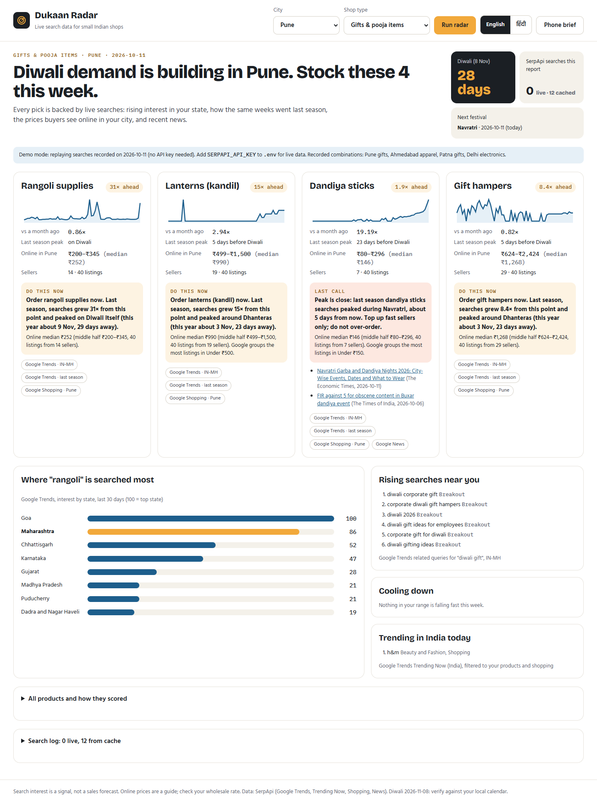
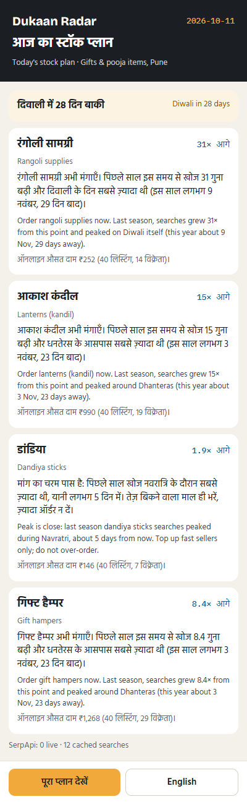
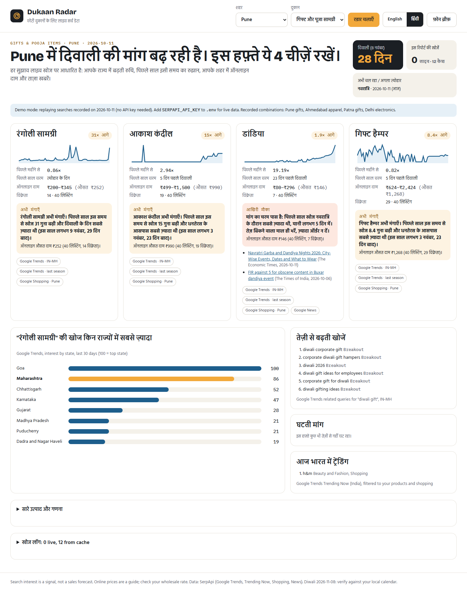

# Dukaan Radar

**Tells a small Indian shop what its city will want to buy in the next few weeks, using live search data, in English and Hindi.**

A gift shop in Pune, a saree shop in Ahmedabad and an electronics dealer in Delhi all make the same bet every festival season: what to order, how much, and when. Today that bet is gut feel. Dukaan Radar reads what people in their state are searching for right now, replays how the same weeks went last season, checks the prices buyers see online in their city and scans recent news, then writes a short stock plan: **order now**, **last call**, **at peak** or **cooling down**, with the evidence behind every line.

Built for the [SerpApi India Hackathon 2026](https://serpapi.github.io/serpapi-india-hackathon-2026/) · Track: **Commerce & Market Intelligence**



| Phone brief (Hindi + English) | Dashboard in Hindi |
| --- | --- |
|  |  |

## What it found on 11 Oct 2026 (real data)

- **Pune, gifts:** dandiya searches are up **19×** in a month, but last season they peaked *during Navratri*, about 5 days from now, so it says **last call** and warns against a big order. *Akash kandil* (Maharashtra's Diwali lanterns) still has **15×** growth ahead and peaks around Dhanteras: **order now**. "Diwali corporate gift" is a breakout search in Maharashtra.
- **Ahmedabad, apparel:** chaniya cholis are already **at peak** mid-Navratri (4.1× in a month); silk sarees have **8.6×** growth ahead.
- **Delhi, electronics:** **room heaters** grew **16×** from this point last season. The states searching most are Sikkim, Arunachal Pradesh, and Jammu and Kashmir.
- **Patna, gifts:** rangoli still has **71×** growth ahead before Diwali.

## Run it

Needs [uv](https://docs.astral.sh/uv/) (it installs Python 3.12 and the dependencies).

```bash
git clone https://github.com/<you>/dukaan-radar && cd dukaan-radar
uv sync
uv run uvicorn dukaan.app:app        # open http://127.0.0.1:8000
```

- **No API key? It runs in demo mode.** It replays 49 searches recorded on 11 Oct 2026 for Pune gifts, Ahmedabad apparel, Patna gifts and Delhi electronics, and never calls the API.
- **Live data:** `cp .env.example .env`, add your key from <https://serpapi.com/manage-api-key>, restart, then pick any city and shop type. A new city/shop combination costs about 11 searches. After that, results are cached.
- `uv run pytest`: 9 tests (signal maths, full reports from the demo data with zero live searches, all pages in both languages, and a check that the API key never appears in shipped files).

## How it uses SerpApi

Every pick, price and warning comes from a live search. Without SerpApi there is no plan.

| Engine | Parameters | What it contributes | Cache |
| --- | --- | --- | --- |
| **Google Trends**, time series | `geo=IN-MH` (the shop's state), `date=today 3-m`, 5 products per call | Momentum: the last 7 days vs a month earlier | 12 h |
| **Google Trends**, last season | `date=<the same weeks before Diwali 2025>` | **Season replay**: at this distance before the festival, how much did searches still grow, and when did they peak? This drives "order now" vs "last call" | 30 days (history does not change) |
| **Google Trends**, interest by region | `geo=IN`, `region=REGION`, `data_type=GEO_MAP_0` | Which states search most for the top pick | 24 h |
| **Google Trends**, related queries | the shop's seed term (e.g. "diwali gift"), `geo=IN-MH` | Breakout searches, e.g. "diwali corporate gift" | 24 h |
| **Google Trends Trending Now** | `geo=IN` | Today's breakouts that touch the shop's products | 6 h, shared |
| **Google Shopping** | `location=<city>`, `gl=in` | Online price range (median, middle half), seller count, and Google's own price bands | 24 h |
| **Google News** | the picks with "price", `gl=in` | Recent headlines naming a product; supply and price words become warnings | 12 h |

**Budget-aware by design.** The free plan has 250 searches a month. A report is about 11 searches the first time. A local SQLite cache (`dukaan/serp.py`) reuses every response until it goes stale, last season's curves are cached for a month, and the dashboard's *search log* shows every call and whether it was live or cached. Building, testing and the demo used 49 searches in total.

**India-first.** State-level Trends codes (IN-MH, IN-GJ, IN-BR…), city locations validated with SerpApi's Locations API, a festival calendar (Navratri, Dussehra, Dhanteras, Diwali, Christmas) that names the festival behind each peak, and every action written in Hindi as well as English.

## How a pick is scored

For each of the shop type's 10 products:

1. **Momentum** = (last 7 days + 1) / (days 28–56 ago + 1), from this season's state curve.
2. **Season replay**: at the same number of days before Diwali 2025, take the interest level, then the peak up to Diwali. *Growth left* = peak / level then; *peak timing* = days before the festival.
3. **Score** = log(growth left) + ½·log(momentum), minus a penalty when search volume is too thin to trust.
4. **Action**: growth left ≥ 1.5 and the peak more than a week away means **order now**; peak within a week means **last call**; rising but no growth left means **at peak**; falling means **cooling down**. The text is written from templates in English and Hindi, so the advice can never be invented.

## Code

| Path | What |
| --- | --- |
| `dukaan/serp.py` | SerpApi client, SQLite cache, live/cached tally, API-key scrubbing, demo mode |
| `dukaan/signals.py` | Pure functions: momentum, season replay, state ranking, rising and trending searches, price summary, news flags |
| `dukaan/report.py` | Orchestrates the searches, scores products, writes bilingual actions |
| `dukaan/config.py` | Shop types (Hindi names), cities, festival calendar |
| `dukaan/app.py`, `templates/`, `static/` | FastAPI dashboard and phone brief |
| `demo/` | 49 recorded searches (API key scrubbed) for running without a key |
| `scripts/` | Probe, demo snapshot and screenshot helpers |

## Limits, honestly

- Search interest is a signal, not a sales forecast. A rangoli search may be for designs, not colours.
- Season replay assumes festivals keep a similar rhythm year to year. The 2026 Diwali date (8 Nov) comes from published calendars; check it against your local panchang.
- Online prices are a guide, not your wholesale rate.
- Trends values are relative within each 5-product call, so products are compared by their own growth rather than raw volume.

## Disclosures

Built during the hackathon window (started 11 Oct 2026) with AI assistance: Claude (Anthropic) helped design, write and test the code and wrote the Hindi templates; the concept was drafted in Claude Design. Uses SerpApi, FastAPI, Jinja2 and uv. MIT licence.
